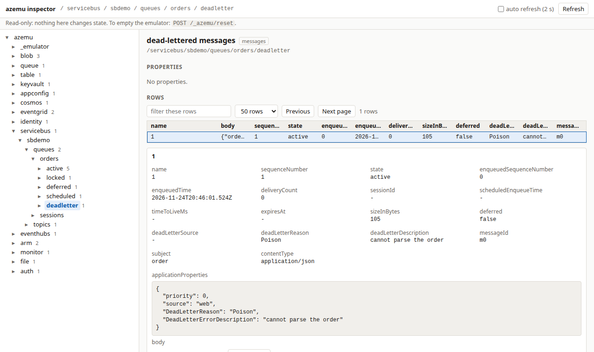

# The inspector

When a test fails, what is in the emulator? Which containers and blobs exist, what is in a queue or a dead-letter queue, which Cosmos DB documents a query should
have found, whether Event Grid delivered. The inspector answers with one read-only HTTP API over every service (`/_azemu/inspect`) and a page that shows it
(`/_azemu/ui`). Nothing in it changes state: to empty the emulator use `POST /_azemu/reset`.

Open `http://localhost:4577/_azemu/ui` (the gateway port). The page is built into the binary: no build step, no network, no CDN, works offline.



## The page

- **The tree on the left** has the emulator itself (`_emulator`: health, configuration, the operations asked for and not built, the fault rules), then each service, its
  accounts (storage accounts, vaults, stores, namespaces, subscriptions, Cosmos DB accounts) and what is in them. A node opens when you click its arrow or its name.
- **The node on the right** shows its properties, its children, and its rows with paging (10 to 500 a page, or `limit=` in the address). A click on a row
  opens it below the table: a message with its system properties, application properties and body, a document or an event as formatted JSON, a blob's first bytes as text
  or as a hex dump. The filter box filters the rows of the page you see; a node that has query parameters of its own (`prefix`, `partition`, `from`, ...) shows an input for each.
- **The start page** (`#/`) shows what is running (version, services, ports, the settings that differ from their defaults), the operations that were asked for and are not
  built, and the active fault rules: the three things that most often explain a surprising result.
- **Refresh** reads the open node again; **auto refresh** does it every 2 seconds, for the open node only. A table keeps its columns between refreshes.
- **Deep links:** the address after `#` is the node's path, so `.../_azemu/ui#/servicebus/myns/queues/orders/deadletter` can be pasted into a bug report.
- Light and dark follow the system. It is usable at 1280 px and at half that.

What the page does not do: it changes nothing. It has no buttons that write.

## The API

`GET /_azemu/inspect` lists the mounted services with the number of accounts each has. Below it: `/_azemu/inspect/{service}`, `/{service}/{account}`, and then what the
service has. Every node answers the same shape:

```json
{
  "path": "/servicebus/myns/queues/orders",
  "kind": "queue",
  "title": "orders",
  "properties": { "lockDurationMs": 60000, "activeMessages": 12, "...": "settings, counts, timestamps" },
  "children": [ { "name": "active", "kind": "messages", "count": 12, "path": "/servicebus/myns/queues/orders/active" } ],
  "items": [ ],
  "next": null
}
```

- `children` are the nodes below this one, with a count when it is cheap. `items` are the rows of a list node (messages, blobs, entities, documents). A row with a `path` is a
  node of its own. `next` is an opaque marker: ask again with `?marker=<next>` for the next page; `null` is the last page. `?limit=` is the page size (default 50, at most 500).
- A node may also have `content` (the first 64 KiB of a blob or file, asked for with `?content=1`), `parameters` (the query parameters it understands) and `views` (other
  ways to look at it: `content=1`, `reveal=1`).
- A body (a blob, a message, an event) is `{"size", "shown", "truncated", "text"}` when the first 64 KiB are text, and `{"size", "shown", "truncated", "base64"}` when
  they are not.
- **A row and an answer have a size.** A row of a list carries at most 128 KiB (a body of 64 KiB and the properties around it); a value that does not fit is shown as
  `{"cut": true, "bytes": <the whole length>, "preview": "<the first 256 characters>"}`, the largest value of the row first. Table shows each long string or binary value cut in the same way
  (`{"type", "value": <the first of it>, "cut": true, "bytes": n}`), and Cosmos DB's documents over 16 KiB are `{"shownInTheNode": true, "bytes": n}` (open the document's own node). The rows of one
  answer add up to at most 4 MiB: a page that would be longer ends early, and `next` goes on from the first row left out, so every row is still reached. A row's `properties` hold what a client
  stored (a Cosmos DB stored procedure's own properties are under `properties`, never in the row's `path` or `name`).
- Names are escaped in paths: a blob called `dir/a b.txt` is `.../blobs/dir%2Fa%20b.txt`.
- A path that names an account, container, queue or anything else that does not exist is `404`, a bad `limit` or `marker` is `400`. Only `GET` and `HEAD` are taken (`405` otherwise).
- `GET /_azemu/` lists the inspector and the page.

### What "read-only" guarantees

The inspector reads the stored state and nothing else. No message is locked, received, peeked with side effects or counted as delivered; no time to live, lock expiry or retention
is applied on the way (a message whose lock ran out is shown as locked, with the lock's end, until the service's own ticker releases it); no sequence number, change feed position, ETag,
dequeue count or last-access time moves; no lazily created account comes into being because someone looked at its path. The tests of each service read the counters a client
can see before and after a full walk of the tree and assert they are equal (Service Bus, Queue, Event Hubs, Cosmos DB, Blob, File, Event Grid and the others).

### Secrets

- A Key Vault secret's **value is not in any list**, and not in the secret's own node either, unless the request is for that one secret (or one version of it) with `?reveal=1`.
  The secret behind a certificate is never revealed. Private key material (the private parts of a key, a certificate's private key or PFX) is never returned, with or without `reveal`.
- Authorization rules of Service Bus and Event Hubs are shown with their names and rights, never their keys. A Service Bus lock token and an Event Grid lock token are never shown.
- Everything else a test wrote (message bodies, documents, blob contents) is shown as it is. **Anyone who can reach the port could already read all of this through the services;
  the inspector does not change who can see what** (see [`../SECURITY.md`](../SECURITY.md)).
- Admin paths refuse a request that another web site sent (`403 CrossSiteRequestRefused`), the page's files and `?reveal=1` included.

### Paths

Below `/_azemu/inspect`. `{x}` is a name; every list node takes `?limit=` and `?marker=`.

| Service | Paths | Notes |
|---|---|---|
| `_emulator` | `/_emulator`, `/_emulator/health`, `/_emulator/config` (rows: the settings in force), `/_emulator/unsupported` (rows: the operations asked for; `storedOnly` in the properties), `/_emulator/faults` (rows: the rules) | the same as `/_azemu/health`, `config`, `unsupported`, `faults` |
| `blob` | `/blob/{account}`, `.../containers`, `.../deleted-containers`, `.../containers/{c}`, `.../containers/{c}/blobs`, `.../blobs/{name}`, `.../blobs/{name}/blocks`, `.../snapshots`, `.../versions` | `blobs` takes `?prefix=` and `?delimiter=` (rows of type `prefix` are the virtual directories); a blob takes `?snapshot=`, `?version=` and `?content=1`. Data Lake Gen2 (`dfs`) shares these accounts and has no inspector of its own |
| `queue` | `/queue/{account}/queues`, `.../queues/{q}`, `.../queues/{q}/messages` | every message, the invisible ones too, with dequeue count, insertion, expiry and next-visible time; text decoded as well when it is base64 of text; `?prefix=` on the queue list |
| `table` | `/table/{account}/tables`, `.../tables/{t}`, `.../tables/{t}/entities` | `?partition=` and paging by key; every property with its Edm type |
| `file` | `/file/{account}/shares`, `.../deleted-shares`, `.../shares/{s}`, `.../shares/{s}/files/{dir}/{file}`, `.../snapshots[/{time}[/files/...]]` | `?content=1` on a file |
| `keyvault` | `/keyvault/{vault}/secrets`, `.../keys`, `.../certificates` (each `/{name}`, `/{name}/versions`, `/{name}/versions/{version}`), `.../deletedsecrets`, `.../deletedkeys`, `.../deletedcertificates`, `.../issuers` | `?reveal=1` on one secret or secret version; a key shows its public JWK only |
| `appconfig` | `/appconfig/{store}/keyvalues`, `.../revisions`, `.../snapshots`, `.../snapshots/{name}`, `.../snapshots/{name}/items` | `?key=` (start of the key) and `?label=` (`(null)` is the null label) |
| `cosmos` | `/cosmos/{account}/databases`, `.../databases/{db}/containers`, `.../containers/{c}`, `.../containers/{c}/documents`, `.../documents/{id}`, `.../sprocs`, `.../triggers`, `.../udfs` | `?partitionKey=` (`["a"]` or `a`); a container shows its partition key, indexing policy, TTL, unique keys, document count and the length of the change feed; documents past their TTL are left out and not removed |
| `servicebus` | `/servicebus/{ns}/queues`, `.../queues/{q}`, `.../queues/{q}/{active,locked,deferred,scheduled,deadletter,transfer-deadletter,sessions}`, `.../topics`, `.../topics/{t}`, `.../topics/{t}/scheduled`, `.../topics/{t}/subscriptions/{s}` (the same message lists), `.../subscriptions/{s}/rules` | a message has its system properties, application properties and body; a locked message its lock's end and holder; the authorization rules of the namespace and the entity are in the properties |
| `eventhubs` | `/eventhubs/{ns}/hubs`, `.../hubs/{h}`, `.../hubs/{h}/partitions`, `.../partitions/{p}`, `.../kafka-groups`, `.../kafka-groups/{g}`, `.../schemagroups`, `.../schemagroups/{g}/schemas/{name}` | a partition shows its begin and last sequence numbers and offsets and its events from `?from=<sequence number>`; Kafka committed offsets are under each namespace. The `kafka` endpoint is these same namespaces (it has no inspector of its own) |
| `eventgrid` | `/eventgrid/{topic, domain, namespace or source}`, `.../subscriptions/{s}`, `.../topics/{t}/subscriptions/{s}`, then `deliveries`, `deadletters`, `events` (the pull queue), `pending` (push deliveries waiting for a retry) | the delivery log and dead letters are also at `/_azemu/eventgrid/...`, which still work |
| `arm` | `/arm/{subscription}`, `.../resourcegroups`, `.../resourcegroups/{g}`, `.../resources` (`?type=`, `?name=`), `.../resources/{id}`, `.../deployments`, `.../deployments/{name}`, `.../deployments/{name}/operations` | each resource says whether anything is emulated behind it (`storedOnly`); subscription-level resources and deployments are under `/arm/{subscription}` |
| `auth` | `/auth/registry`, `.../assignments` (`?principal=`), `.../roles` | the role assignments and role definitions that `--strict-auth` decides with |
| `identity` | `/identity/signer` | the signing key id and how many tokens it has signed; nothing secret |
| `monitor` | `/monitor/sink`, `.../telemetry` (`?ikey=`, `?type=`, `?name=`, `?operationId=`), `.../logs` (`?dcr=`, `?stream=`) | |

## Tried

Cargo tests per service crate (tree walks with a small `limit`, the "looking changes nothing" counters, missing accounts), a walk of the whole tree of a filled emulator
(`crates/azemu/tests/inspect.rs`), the page's headers and files (`crates/core/tests/inspect.rs`), and the page itself in a headless Chrome
([`../tests/inspector-ui/check.mjs`](../tests/inspector-ui/check.mjs): one path per service, a click on a row, the reveal button, auto refresh; fails on any console error).
Also clicked through in a real Chrome, driven by a browser tool (so not by a person), against an emulator filled with the Python SDKs (Blob, Queue, Table, File, Service Bus, Event Hubs) and plain HTTP for the others: the tree, filters, paging, a deep link and a reload, a secret with and without the button, auto refresh, dark mode, and a window of 640 px.

Not covered: Safari and Firefox (the page uses nothing newer than 2020), and a page open for hours with auto refresh.
